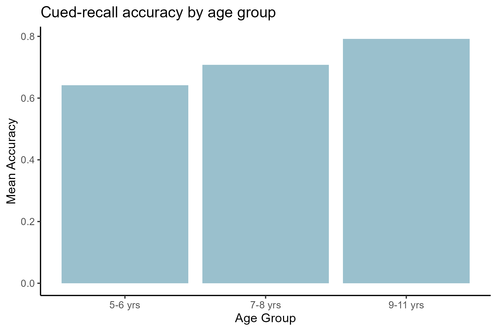
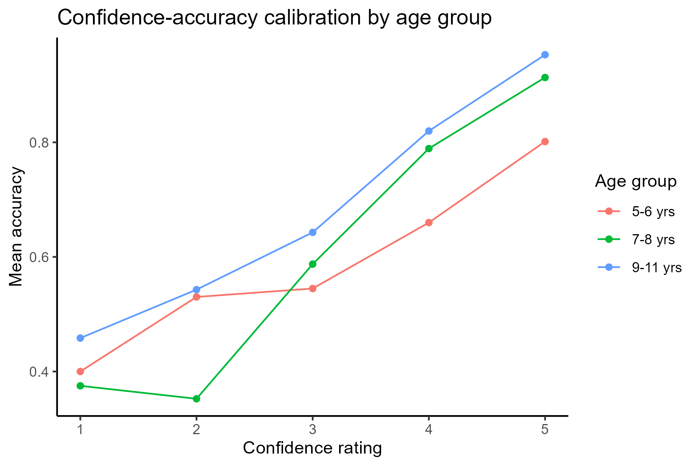

# Child Memory and Metacognition: A Cued-Recall Analysis

**Emma Higgins | 2026**

## Overview

This project explores whether children's confidence in their memory reports can be used to assess the accuracy of the reports, using data from a cued-recall memory study of children from 5-11 years old. This dataset comes from Colloff 2025 at the University of Birmingham, investigating how legal decision-makers (police, judges, jurors) might use children's metacognitive cues, like confidence ratings, to gauge the reliability of witness testimony. 

## Research Questions 

1. How does memory accuracy in a cued-recall task change across childhood (ages 5-6, 7-8, and 9-11)? 
2. Do children's confidence ratings track the actual accuracy of their answers, and does the calibration improve with age? 
3. After accounting for confidence, does age still independently predict accuracy? 

## Key Findings 

**Plot 1 - Accuracy Increases with Age**
The mean accuracy on the cued-recall task rose steadily across age groups, with 64% correct among 5-6 year olds, 71% among 7-8 year olds, and 79% among 9-11 year olds. 

**Plot 2 - Confidence Tracks Accuracy, Especially in Older Children**
Across all age groups, higher confidence ratings were associated with higher accuracy. The relationship was strongest and most linear for 9-11 year olds, while younger children's confidence ratings were somewhat less diagnostic of whether or not their answer was correct. 

**Statistical Model** 
A mixed-effects logistic regression (accounting for repeated measures within each child) confirmed both patterns observed above. Each one-point increase in confidence was associated with about 2.17 times greater odds of being correct (b = 0.77, p < .001), and each step up in age group was associated with roughly 1.5 times greater odds of being correct (b = 0.41, p < .001), independent of confidence. 

## Why This Matters 

These findings speak directly to a real-world problem: legal decision-makers currently have little to no empirically-grounded guidance for assessing the accuracy of children's memory reports, and often rely on age alone, which is an unreliable method of discretion. This analysis suggests that children's own confidence ratings carry meaningful information about the accuracy of their memories, even in children as young as 5 years old, and that this signaling becomes more reliable with age. Tools that help legal practitioners attend to these metacognitive cues, rather than age alone, could improve outcomes for child witnesses and reduce wrongful reliance on inaccurate testimony. 

## Data Source

Colloff, Melissa (2025). *Harnessing Metacognition to Assess the Accuracy of
Memory Reports From Children in the Criminal Justice System, 2021-2024.*
[Data Collection]. Colchester, Essex: UK Data Service.
[10.5255/UKDA-SN-858013](https://doi.org/10.5255/UKDA-SN-858013)

**Note:** The raw data file is not included in this repository per UK Data
Service redistribution terms. To reproduce this analysis, request access to
the dataset directly from the
[UK Data Service](https://doi.org/10.5255/UKDA-SN-858013) and place
`Cued_Recall_Datafile.xlsx` in the project root.

## Tools

- R 4.3.1
- tidyverse (ggplot2, dplyr)
- readxl
- lme4

## How to Run

1. Install R and RStudio
2. Install required packages: `install.packages(c("tidyverse", "readxl", "lme4"))`
3. Obtain `Cued_Recall_Datafile.xlsx` (see Data Source above) and place it in
the project root
4. Run `analysis.R`

## About

Exploratory analysis of children's memory accuracy and metacognitive
confidence using cued-recall data from an ESRC-funded study on child
witnesses in the criminal justice system.